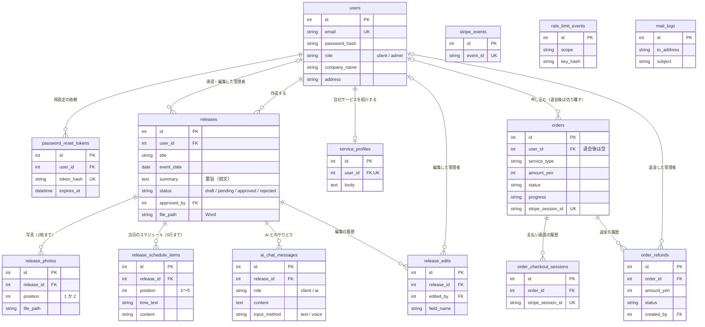
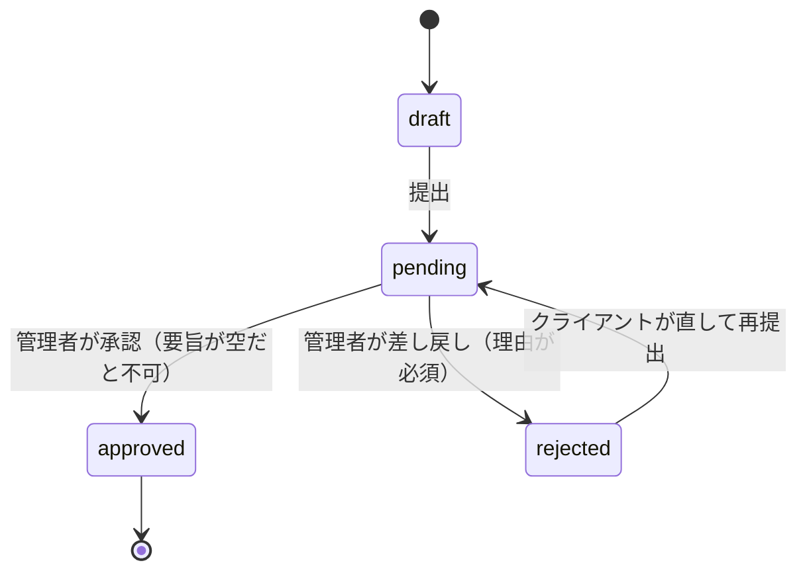
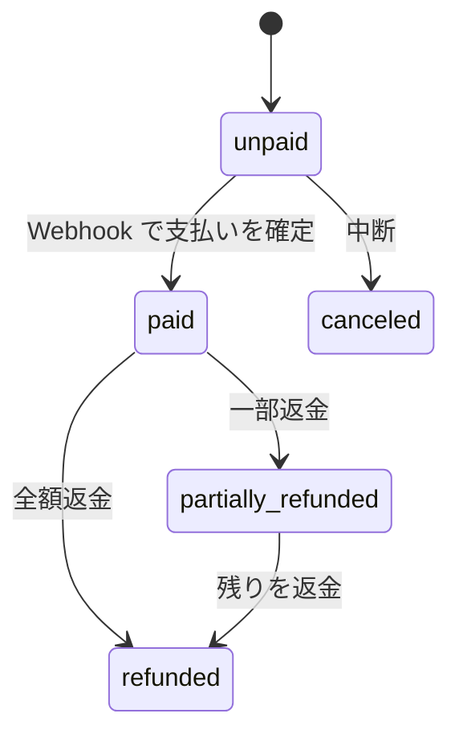

# データベース設計

テーブルは14個。定義は [app/models.py](../../app/models.py)、変更の履歴は `migrations/versions/`（Flask-Migrate）にある。このファイルの列の一覧は、モデルから取り出したもの。値の決まりや返金の規則などの細かい説明は [../データベース設計.md](../データベース設計.md) を参照。

- データベース：開発とテストは SQLite、VM（デモ）は MySQL 8（文字コード `utf8mb4`）。SQLAlchemy を通して使い、どちらでも同じコードで動く。
- 全テストを、SQLite と MySQL の両方で通している。

## 1. ER 図

- `stripe_events`、`rate_limit_events`、`mail_logs` は、ほかのテーブルとつながらない記録用のテーブル。

## 2. 共通のルール

| 項目 | ルール |
| --- | --- |
| 主キー | 各テーブルに `id`（整数、自動採番） |
| 日時 | UTC で保存し、画面に出すときに日本時間にする |
| 金額 | 整数（円、税込） |
| 状態・種類 | 文字列で保存し、取りうる値はアプリ側で制限する（データベース固有の ENUM 型は使わない） |
| 文字列 | 長さを必ず付ける（MySQL で動かすため） |
| 秘密の値 | パスワードとトークンは、ハッシュにして保存する。元の値は保存しない |
| 変更 | データベースの変更は、必ずマイグレーションにする |

## 3. 状態の値

### 3-1. 書類（releases.status）

| 値 | 意味 |
| --- | --- |
| `draft` | 下書き。管理者には見えない |
| `pending` | 承認待ち |
| `approved` | 承認済み。Word を出力済みで、以後は編集できない |
| `rejected` | 差し戻し |

### 3-2. 注文（orders.status と orders.progress）

| 進捗（progress） | 意味 | 返金の上限 |
| --- | --- | --- |
| `received` | 受付（支払いの確定で、この値になる） | 全額 |
| `in_progress` | 着手 | 50% |
| `delivered` | 納品済み | 不可 |

### 3-3. そのほかの値

| 列 | 値 |
| --- | --- |
| users.role | `client`（初期値）、`admin` |
| orders.service_type | `release_creation`（リリース作成の追加）、`interview_planning`（記者発表会の企画・当日の同席）、`distribution_proxy`（投げ込み交渉代行）、`article_creation`（記事制作）、`video_creation`（動画制作） |
| releases.summary_source | `manual`（管理者が作成）、`ai_assisted`（第2弾） |
| service_profiles.input_method | `text`、`voice`（第2弾） |
| order_refunds.status | `pending`、`succeeded`、`failed` |

## 4. 退会したときの動き

| テーブル | 動き |
| --- | --- |
| password_reset_tokens、releases、service_profiles | 会員と一緒に消える（`ON DELETE CASCADE`）。写真と Word のファイルも消す |
| release_photos、release_schedule_items、release_edits、ai_chat_messages | 書類と一緒に消える（CASCADE） |
| orders | 消さずに残す。`user_id` を空にし（`SET NULL`）、素材のリンクと納品物を消す。金額・日付・状態は残す |
| order_checkout_sessions、order_refunds | 注文と一緒に残る |
| 管理者を指す列（approved_by、last_edited_by、edited_by、created_by） | 管理者を消したときは空にする（`SET NULL`） |

## 5. テーブル定義

型：整数、文字列(長さ)、テキスト（長い文字列）、日付、時刻、日時。必須の「○」は NOT NULL。

### 5-1. users（会員）

| 列 | 型 | 必須 | 制約・メモ |
| --- | --- | --- | --- |
| id | 整数 | ○ | 主キー |
| email | 文字列(255) | ○ | 一意。ログインに使う |
| password_hash | 文字列(255) | ○ | パスワードのハッシュ |
| session_nonce | 文字列(32) | ○ | パスワードを変えたときに、古いログインを無効にするための値 |
| role | 文字列(20) | ○ | `client` / `admin` |
| company_name | 文字列(255) | ○ | 社名 |
| postal_code | 文字列(8) | ○ | 郵便番号 |
| address | 文字列(500) | ○ | 住所（投げ込みガイドの都道府県に使う） |
| contact_name | 文字列(100) | ○ | 担当者名 |
| phone | 文字列(20) | ○ | 電話番号 |
| mobile_phone | 文字列(20) | | 携帯電話番号 |
| logo_path | 文字列(500) | | ロゴ画像の保存場所 |
| department | 文字列(100) | | 担当部署 |
| founded / capital / employees | 文字列(50) | | 設立・資本金・従業員数（Word の会社概要に載せる） |
| business_description | テキスト | | 事業内容 |
| website_url | 文字列(500) | | ウェブサイト |
| created_at / updated_at | 日時 | ○ | |

### 5-2. password_reset_tokens（パスワード再設定）

| 列 | 型 | 必須 | 制約・メモ |
| --- | --- | --- | --- |
| id | 整数 | ○ | 主キー |
| user_id | 整数 | ○ | → users.id（CASCADE）、インデックス |
| token_hash | 文字列(64) | ○ | 一意。トークンのハッシュ |
| expires_at | 日時 | ○ | 期限 |
| used_at | 日時 | | 使った日時（1回限り） |
| created_at | 日時 | ○ | |

### 5-3. releases（プレスリリースの書類）

| 列 | 型 | 必須 | 制約・メモ |
| --- | --- | --- | --- |
| id | 整数 | ○ | 主キー |
| user_id | 整数 | ○ | → users.id（CASCADE）、インデックス |
| title | 文字列(200) | ○ | タイトル（「【取材のお願い】」の後ろ。全角22文字以内） |
| event_date | 日付 | | 取材会の日付（提出時は必須） |
| event_start_time / event_end_time | 時刻 | | 開始・終了時刻（終了は任意） |
| location | 文字列(300) | ○ | 場所 |
| service_description | テキスト | ○ | サービスや商品の概要 |
| feature_1 / feature_2 / feature_3 | 文字列(200) | ○ | 特徴（空文字で「なし」） |
| application_method | テキスト | ○ | 取材の申込方法 |
| application_deadline_at | 日時 | | 申込の締切 |
| source_what / source_why / source_message | テキスト | ○ | 要旨の元になる3つの質問の答え（各500文字まで） |
| summary | テキスト | | 要旨（前文）。管理者が書く。空だと承認できない |
| summary_source | 文字列(20) | ○ | `manual` / `ai_assisted` |
| status | 文字列(20) | ○ | 状態。インデックス |
| first_submitted_at | 日時 | | 初めて提出した日時（無料枠の数え方に使う） |
| submitted_at | 日時 | | 最後に提出した日時 |
| reject_reason | テキスト | | 差し戻しの理由 |
| approved_by | 整数 | | → users.id（SET NULL）。承認した管理者 |
| approved_at | 日時 | | 承認日時（Word の発信日） |
| last_edited_by | 整数 | | → users.id（SET NULL） |
| last_edited_at | 日時 | | |
| file_path | 文字列(500) | | 出力した Word の保存場所 |
| created_at / updated_at | 日時 | ○ | |

### 5-4. release_photos（書類の写真）

| 列 | 型 | 必須 | 制約・メモ |
| --- | --- | --- | --- |
| id | 整数 | ○ | 主キー |
| release_id | 整数 | ○ | → releases.id（CASCADE）、インデックス |
| position | 整数 | ○ | 1 か 2（CHECK 制約）。(release_id, position) で一意 |
| file_path | 文字列(500) | ○ | 保存場所 |
| original_filename | 文字列(255) | ○ | 元のファイル名 |
| content_type | 文字列(50) | ○ | 画像の形式 |
| size_bytes | 整数 | ○ | 大きさ |
| created_at | 日時 | ○ | |

### 5-5. release_schedule_items（当日のスケジュール）

| 列 | 型 | 必須 | 制約・メモ |
| --- | --- | --- | --- |
| id | 整数 | ○ | 主キー |
| release_id | 整数 | ○ | → releases.id（CASCADE）、インデックス |
| position | 整数 | ○ | 1〜5（CHECK 制約）。(release_id, position) で一意 |
| time_text | 文字列(50) | ○ | 時間 |
| content | 文字列(200) | ○ | 内容 |

### 5-6. release_edits（管理者の編集履歴）

| 列 | 型 | 必須 | 制約・メモ |
| --- | --- | --- | --- |
| id | 整数 | ○ | 主キー |
| release_id | 整数 | ○ | → releases.id（CASCADE）、インデックス |
| edited_by | 整数 | | → users.id（SET NULL）。編集した管理者 |
| edited_at | 日時 | ○ | |
| field_name | 文字列(50) | ○ | 変えた項目 |
| old_value / new_value | テキスト | | 変更前・変更後 |

### 5-7. service_profiles（自社サービスの紹介）

| 列 | 型 | 必須 | 制約・メモ |
| --- | --- | --- | --- |
| id | 整数 | ○ | 主キー |
| user_id | 整数 | ○ | → users.id（CASCADE）。一意（1人1件） |
| input_method | 文字列(10) | ○ | `text` / `voice` |
| body | テキスト | ○ | 本文（2,000文字まで）。空にして保存すると、行ごと消す |
| created_at / updated_at | 日時 | ○ | |

### 5-8. orders（注文）

| 列 | 型 | 必須 | 制約・メモ |
| --- | --- | --- | --- |
| id | 整数 | ○ | 主キー |
| user_id | 整数 | | → users.id（SET NULL）。退会後は空。インデックス |
| service_type | 文字列(30) | ○ | サービスの種類 |
| service_name | 文字列(100) | ○ | 申込み時のサービス名 |
| service_option | 文字列(30) | | 料金の選択肢（地域、動画の長さ） |
| service_media | 文字列(30) | | 動画を出す媒体 |
| amount_yen | 整数 | ○ | 申込み時の金額。50円以上（CHECK 制約） |
| status | 文字列(20) | ○ | 状態。インデックス |
| progress | 文字列(20) | | 進捗（支払いの確定後に使う） |
| due_date | 日付 | | 納期日 |
| refunded_amount | 整数 | ○ | 返金額の合計。0以上、amount_yen 以下（CHECK 制約） |
| refund_reason | テキスト | | 返金の理由 |
| materials_url | 文字列(500) | | 素材の共有リンク（動画） |
| delivery_file_path / delivery_filename | 文字列(500) / 文字列(255) | | 納品した記事のファイル |
| delivery_url | 文字列(500) | | 納品した動画のリンク |
| free_revisions_used | 整数 | ○ | 無料の修正を使った回数 |
| checkout_attempts | 整数 | ○ | 支払い画面を作った回数 |
| stripe_session_id | 文字列(255) | | 一意。最新の Stripe の支払い画面 |
| stripe_payment_intent_id | 文字列(255) | | 一意。返金に使う |
| paid_at / delivered_at / disputed_at | 日時 | | 支払い・納品・異議申し立ての日時 |
| created_at / updated_at | 日時 | ○ | |

### 5-9. order_checkout_sessions（支払い画面の履歴）

| 列 | 型 | 必須 | 制約・メモ |
| --- | --- | --- | --- |
| id | 整数 | ○ | 主キー |
| order_id | 整数 | ○ | → orders.id（CASCADE）、インデックス |
| stripe_session_id | 文字列(255) | ○ | 一意。古い支払い画面から払われたときに、注文を見つけるため |
| created_at | 日時 | ○ | |

### 5-10. order_refunds（返金の履歴）

| 列 | 型 | 必須 | 制約・メモ |
| --- | --- | --- | --- |
| id | 整数 | ○ | 主キー |
| order_id | 整数 | ○ | → orders.id（CASCADE）、インデックス |
| amount_yen | 整数 | ○ | 返金額。0より大きい（CHECK 制約） |
| reason | 文字列(30) | ○ | `policy` / `no_media` / `slot_unused` / `external` |
| note | テキスト | | メモ |
| status | 文字列(20) | ○ | `pending` / `succeeded` / `failed` |
| stripe_refund_id | 文字列(255) | | 一意 |
| created_by | 整数 | | → users.id（SET NULL）。返金した管理者 |
| created_at | 日時 | ○ | |

### 5-11. stripe_events（受け取った Webhook の記録）

| 列 | 型 | 必須 | 制約・メモ |
| --- | --- | --- | --- |
| id | 整数 | ○ | 主キー |
| event_id | 文字列(255) | ○ | 一意。同じ通知を2回処理しないため |
| event_type | 文字列(100) | ○ | 通知の種類 |
| received_at | 日時 | ○ | |

### 5-12. rate_limit_events（回数制限の記録）

| 列 | 型 | 必須 | 制約・メモ |
| --- | --- | --- | --- |
| id | 整数 | ○ | 主キー |
| scope | 文字列(30) | ○ | 何の制限か（`login_ip`、`login_fail`、`register_ip`、`reset_ip`、`reset_email`、`order_user`、`ai_chat_user`） |
| key_hash | 文字列(64) | ○ | 相手（IP・メールアドレス・会員ID）のハッシュ。元の値は保存しない |
| created_at | 日時 | ○ | インデックス。(scope, key_hash, created_at) にもインデックス |

### 5-13. mail_logs（送信予定のメール）

| 列 | 型 | 必須 | 制約・メモ |
| --- | --- | --- | --- |
| id | 整数 | ○ | 主キー |
| to_address | 文字列(255) | ○ | 宛先。インデックス |
| subject | 文字列(255) | ○ | 件名 |
| body | テキスト | ○ | 本文（再設定のリンクを含むことがあるので、管理者だけが見る） |
| created_at | 日時 | ○ | インデックス |

- デモ（`MAIL_BACKEND=database`）のとき、メールを送る代わりに、ここに記録する。管理者の `/admin/mails` で見る。

### 5-14. ai_chat_messages（AI とのやりとり）

| 列 | 型 | 必須 | 制約・メモ |
| --- | --- | --- | --- |
| id | 整数 | ○ | 主キー |
| release_id | 整数 | ○ | → releases.id（CASCADE）、インデックス |
| role | 文字列(20) | ○ | `client`（クライアントの発言）/ `ai`（AI の返事） |
| content | テキスト | ○ | 発言の本文 |
| input_method | 文字列(10) | ○ | `text` / `voice`（音声入力は、あとで作る） |
| created_at | 日時 | ○ | |

- 書類の入力画面のチャットで、1往復ごとに2行（`client` と `ai`）を足す。AI につながらなかったときは、何も足さない。
- `ai` の行の数を、その書類で AI を呼んだ回数として数える（上限は `AI_MAX_CALLS_PER_RELEASE`）。
- 最初の質問は、決まった文（`app/ai.py` の `FIRST_QUESTION`）なので、保存しない。
