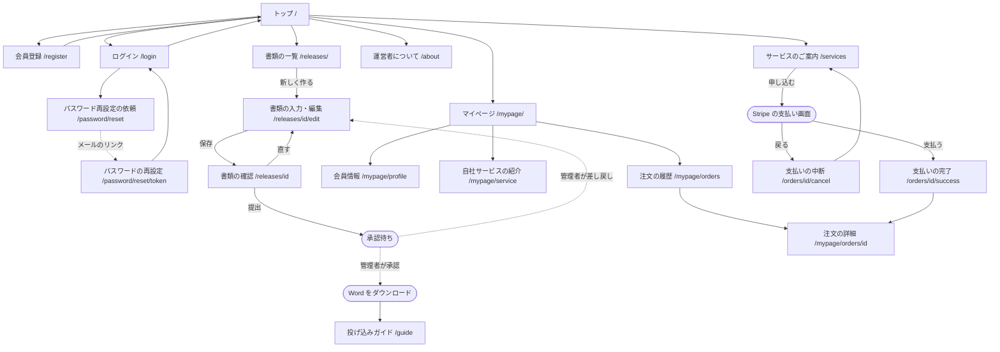
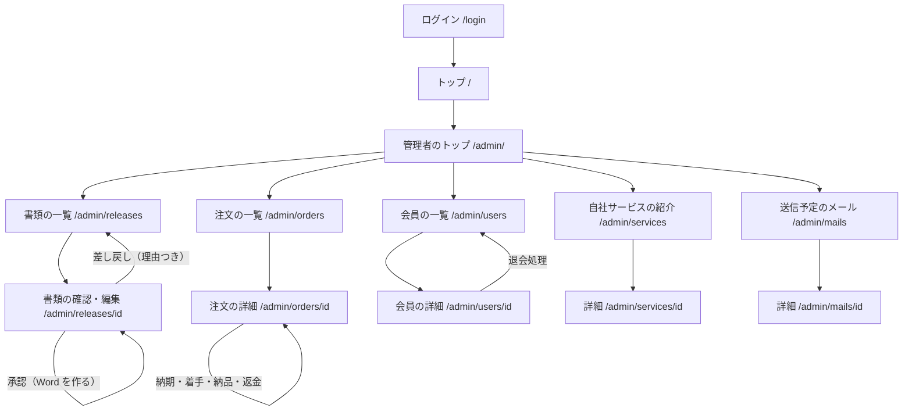

# 画面一覧と遷移

実際のアプリ（`flask routes`）の URL をもとにまとめたもの。ロールの意味は [../spec/requirements.md](../spec/requirements.md) を参照。

- **公開**：ログインしなくても見られる。
- **クライアント**：ログインしたクライアントだけ。管理者が開くと、拒否される。
- **管理者**：ログインした管理者だけ。
- ログインが必要な画面を、ログインせずに開くと、ログイン画面（`/login`）に移る。ログインすると、元の画面に戻る。
- 他人の書類や注文の URL を開いても、見つからない扱い（404）になる。

## 1. 画面一覧

### 1-1. 公開の画面

| 画面 | URL | 主な内容・操作 |
| --- | --- | --- |
| トップ | `/` | ロゴ、紹介文、利用の流れ、サービスの一覧。ログイン前は「会員登録」「ログイン」、クライアントは「プレスリリースを作る」「マイページ」、管理者は「管理者ページへ」のボタン |
| 運営者について | `/about` | 会社紹介、代表者、動画制作担当 |
| サービスのご案内 | `/services` | サービスの内容・料金・注意書き。クライアントは、ここから申し込む（ログイン前は、会員登録・ログインへの案内） |
| 会員登録 | `/register` | 会社情報とパスワードを入力する。登録すると、ログインした状態でトップへ |
| ログイン | `/login` | メールアドレスとパスワード。ログアウトは、ヘッダーのボタン（`POST /logout`） |
| パスワード再設定の依頼 | `/password/reset` | メールアドレスを入力すると、再設定のリンクを送る |
| パスワードの再設定 | `/password/reset/<token>` | メールのリンクから開き、新しいパスワードを決める。終わるとログイン画面へ |

### 1-2. クライアントの画面

| 画面 | URL | 主な内容・操作 |
| --- | --- | --- |
| 書類の一覧 | `/releases/` | 自分の書類と状態（下書き／承認待ち／承認済み／差し戻し）、無料の残り件数。「新しく作る」（`POST /releases/new`）で下書きを作り、入力画面へ |
| 書類の入力・編集 | `/releases/<id>/edit` | ① 取材の日付・時刻・場所をフォームに入力して保存。② AI とのチャット（チャットアプリのような画面。AI が質問し、そろうと、タイトルの案・サブタイトル・特徴・要旨・当日の対応者をまとめる。最後に写真を促す。API キーがなければ「準備中」）。③ 写真のアップロードと削除。④「プレビューへ（提出画面に続きます）」。下書きと差し戻しの書類だけ編集できる |
| 書類の確認 | `/releases/<id>` | 入力内容のプレビュー、足りない項目の表示。提出（`POST /releases/<id>/submit`）、下書きの削除。承認後は Word のダウンロード（`/releases/<id>/download`）と、管理者が直した点の表示 |
| 投げ込みガイド | `/guide` | 投げ込みのしかた。会社の住所から、都道府県名を入れて表示する |
| マイページ | `/mypage/` | 各画面への入口、承認されたプレスリリース（Word をダウンロード）、最近の注文。管理者が開くと、管理者のトップへ移る |
| 会員情報 | `/mypage/profile` | 会社情報の変更、ロゴのアップロードと削除 |
| 自社サービスの紹介 | `/mypage/service` | 自由記述（2,000文字まで）の入力 |
| 注文の履歴 | `/mypage/orders` | 自分の注文の一覧 |
| 注文の詳細 | `/mypage/orders/<id>` | 状態、進捗、納期、返金額、納品物（記事はダウンロード `/mypage/orders/<id>/delivery`、動画はリンク）。未払いなら、支払いをやり直せる（`POST /orders/<id>/pay`） |
| 支払いの完了 | `/orders/<id>/success` | Stripe の支払い画面から戻る先。確定は Webhook で行うので、「お支払いを確認しています」と出ることがある |
| 支払いの中断 | `/orders/<id>/cancel` | Stripe の支払い画面で戻ったときの画面。注文を取り消せる |

### 1-3. 管理者の画面

| 画面 | URL | 主な内容・操作 |
| --- | --- | --- |
| 管理者のトップ | `/admin/` | 承認待ちの書類、支払い済みの注文など、各画面への入口 |
| 書類の一覧 | `/admin/releases` | 状態で絞り込む（承認待ち／承認済み／差し戻し） |
| 書類の確認・編集 | `/admin/releases/<id>` | クライアントと AI のやりとりの確認、AI がまとめた内容（タイトルの案から選ぶ、サブタイトル、要旨、特徴、当日の対応者）の確認と修正、写真の追加と削除、Word の仮出力（`preview.docx`）、承認（`POST .../approve`）、差し戻し（`POST .../reject`、理由つき）、承認後の Word のダウンロード。自社サービスの紹介と、編集の履歴も見られる |
| 注文の一覧 | `/admin/orders` | 状態・進捗・サービスで絞り込む |
| 注文の詳細 | `/admin/orders/<id>` | 納期の設定、着手、納品（記事のファイル／動画のリンク）、納品済みにする、修正回数の記録、返金 |
| 会員の一覧 | `/admin/users` | クライアントの一覧。メールアドレス・会社名・担当者名で検索 |
| 会員の詳細 | `/admin/users/<id>` | 会社情報、書類、注文、自社サービスの紹介。退会処理（`POST .../delete`） |
| 自社サービスの紹介の一覧 | `/admin/services` | 会社名・メール・本文で検索。更新が新しい順 |
| 自社サービスの紹介の詳細 | `/admin/services/<会員id>` | 本文 |
| 送信予定のメールの一覧 | `/admin/mails` | デモでは、送らなかったメールがここに記録される |
| 送信予定のメールの詳細 | `/admin/mails/<id>` | 宛先、件名、本文 |

### 1-4. 画面ではない URL

| URL | 役割 |
| --- | --- |
| `POST /services/<key>/order` | 申込み。注文を作り、Stripe の支払い画面へ移る |
| `POST /releases/<id>/chat` | AI とのチャット（JSON）。持ち主のクライアントだけ、下書きと差し戻しの書類だけ。1つの書類で呼べる回数（`AI_MAX_CALLS_PER_RELEASE`）と、連打の回数制限がある |
| `POST /stripe/webhook` | Stripe からの通知（支払いの確定、取り消し、返金）。署名を確認する。Nginx の合言葉の対象外 |
| `/files/photos/<id>`、`/files/logos/<会員id>` | 写真とロゴの表示。本人と管理者だけ |

## 2. 画面の遷移

### 2-1. クライアント

### 2-2. 管理者

### 2-3. 書類の状態と、画面の関係

| 状態 | クライアントができること | 管理者ができること |
| --- | --- | --- |
| 下書き（draft） | 入力・編集、提出、削除 | 見られない（一覧に出ない） |
| 承認待ち（pending） | 確認だけ | 要旨の作成・編集、承認、差し戻し |
| 差し戻し（rejected） | 理由を見て直し、再提出 | 確認だけ |
| 承認済み（approved） | Word のダウンロード、変更点の確認 | Word のダウンロード |

状態の遷移の詳細は [database.md](database.md) の「状態の値」を参照。
