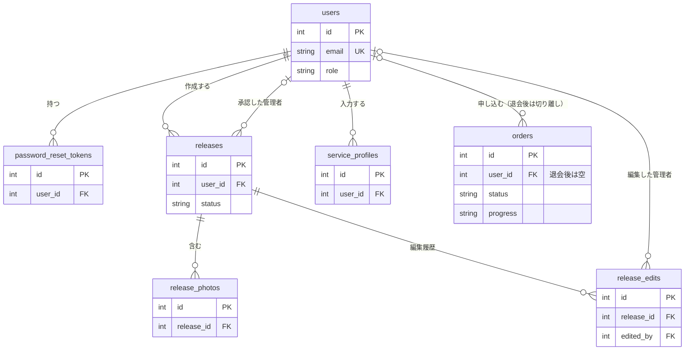
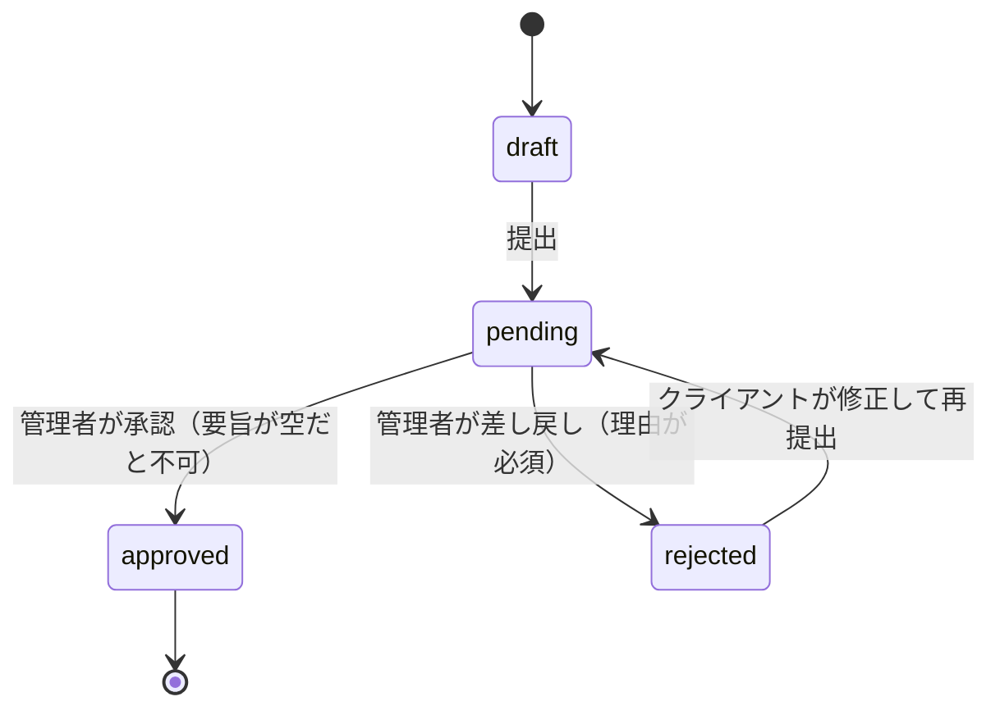
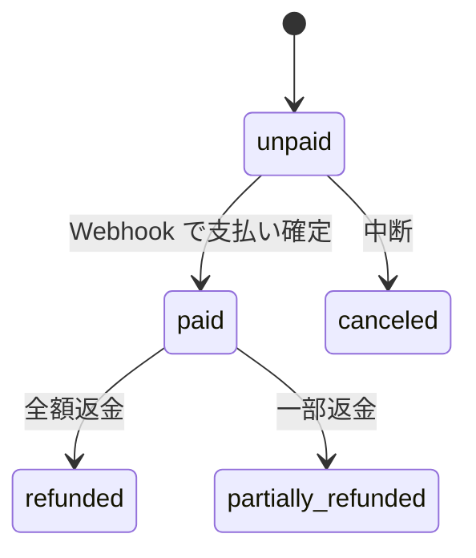

# データベース設計

元になる仕様：[仕様書.md](仕様書.md) の7章。設計は2段階で進める。

| 段階 | 内容 | 状態 |
| --- | --- | --- |
| 第1段階（このファイル） | 全体の関係図、状態の値、共通ルール、段階1で使うテーブルの詳細 | 作成済み |
| 第2段階 | 開発の各段階の前に、その段階で使うテーブルの詳細を追記する（段階2：書類関連、段階3：注文関連） | 未着手 |

## 1. 全体の関係図（ER図）

## 2. 共通ルール

| 項目 | ルール | 理由 |
| --- | --- | --- |
| 文字コード | 本番（MySQL）は `utf8mb4` | 日本語・絵文字を正しく扱う |
| 日時 | UTC で保存し、画面表示のときに日本時間にする | 開発（SQLite）と本番（MySQL）の差を避ける |
| 金額 | 整数（円、税込）で保存する | 小数の誤差を避ける |
| 状態・種類 | 文字列（`VARCHAR`）で保存し、取りうる値はアプリ側で制限する | SQLite と MySQL で同じに動かすため（DB 固有の ENUM 型は使わない） |
| 主キー | 各テーブルに `id`（整数、自動採番） | |
| 作成・更新日時 | 主要テーブルに `created_at`、更新があるものには `updated_at` | |
| マイグレーション | Flask-Migrate（Alembic）で管理する。DB の変更は必ずマイグレーションにする | 本番への反映を安全にする |
| 本番での確認 | 公開前に MySQL で全テストを通す | 仕様書3章の注意のとおり |

## 3. 状態の値と遷移

### 3-1. 書類の状態（releases.status）

| 値 | 意味 |
| --- | --- |
| `draft` | 下書き（クライアントが入力中） |
| `pending` | 承認待ち（提出済み。管理者が要旨を書く・編集する・確認する） |
| `approved` | 承認済み（Word を出力済み。以後は編集不可） |
| `rejected` | 差し戻し（理由付き。クライアントが修正して再提出できる） |

- 無料枠の数え方：初めて提出した書類だけを数える。そのため `first_submitted_at`（初回提出日時）を持ち、差し戻し後の再提出では更新しない。
- `approved` の書類は、クライアント・管理者のどちらも編集できない。

### 3-2. 注文の状態（orders.status）と進捗（orders.progress）

| 状態 | 意味 |
| --- | --- |
| `unpaid` | 未払い（Stripe の支払いを開始した状態） |
| `paid` | 支払済（Webhook で確定） |
| `canceled` | 取消（支払い前に中断） |
| `refunded` | 返金済み（全額） |
| `partially_refunded` | 一部返金 |

| 進捗 | 意味 | 返金の目安 |
| --- | --- | --- |
| `received` | 受付（支払い確定で自動的にこの値になる） | 全額 |
| `in_progress` | 着手（管理者が更新した時点） | 50% |
| `delivered` | 納品済み | 不可 |

- `progress` は `paid` になってから使う（`unpaid` のときは空）。
- 返金後に進捗は戻さない。返金額の合計が支払額を超えないように、`refunded_amount` で管理する。

### 3-3. その他の値

| 項目 | 取りうる値 |
| --- | --- |
| users.role | `client`（初期値）、`admin` |
| orders.service_type | `interview_planning`（取材会の企画支援）、`interview_accompany`（取材会の同行）、`distribution_proxy`（投げ込み代行）、`article_creation`（記事作成）、`video_creation`（動画作成） |
| releases.summary_source（要旨の作成方法） | `manual`（管理者が作成）、`ai_assisted`（AI の案を管理者が修正。第2弾） |
| service_profiles.input_method | `text`、`voice`（第2弾） |

## 4. 削除したときの動き（退会・削除）

退会処理（仕様書 F21）では、ユーザー本人の行を削除し、注文は個人情報を消して残す。

| テーブル | ユーザー削除時の動き |
| --- | --- |
| password_reset_tokens | ユーザーと一緒に削除（`ON DELETE CASCADE`） |
| releases | 一緒に削除（CASCADE）。あわせて Word・写真のファイルも削除する |
| release_photos | 書類と一緒に削除（CASCADE）。ファイルも削除する |
| release_edits | 書類と一緒に削除（CASCADE） |
| service_profiles | 一緒に削除（CASCADE） |
| orders | **削除せず残す**。`user_id` を空にする（`ON DELETE SET NULL`）。素材の共有リンク・納品 URL・納品ファイルは削除する。金額・日付・サービス種別・状態などは残す |
| releases.approved_by / release_edits.edited_by | 管理者を指す。管理者の行は削除しない運用とし、万一削除したら空にする（`SET NULL`） |

## 5. テーブル詳細：段階1（認証）で使うもの

### 5-1. users

| 項目 | 型 | 必須 | 制約・メモ |
| --- | --- | --- | --- |
| id | 整数 | ○ | 主キー |
| email | 文字列(255) | ○ | **一意**。小文字にそろえて保存する |
| password_hash | 文字列(255) | ○ | ハッシュ化したパスワード（元のパスワードは保存しない） |
| session_nonce | 文字列(32) | ○ | セッションの世代（ランダム）。パスワードを変えると更新し、変更前のログイン状態をすべて無効にする |
| role | 文字列(20) | ○ | `client` / `admin`。初期値 `client` |
| company_name | 文字列(255) | ○ | 社名 |
| postal_code | 文字列(8) | ○ | 郵便番号。ハイフン付きの `123-4567` の形にそろえて保存する（入力は、ハイフンの有無・全角を許し、数字7桁に直してから整える） |
| address | 文字列(500) | ○ | 住所（都道府県から番地・建物名まで） |
| contact_name | 文字列(100) | ○ | 担当者名 |
| phone | 文字列(20) | ○（仮） | 電話番号。Word のお問い合わせ先に載せるため必須とする |
| mobile_phone | 文字列(20) | － | 携帯電話番号（任意） |
| logo_path | 文字列(500) | － | ロゴ画像の保存先（任意。段階2で使う） |
| company_profile | 文章 | － | 会社の概要（任意） |
| created_at | 日時 | ○ | |
| updated_at | 日時 | ○ | |

- 管理者（`admin`）は、会社情報の項目を使わないため、社名などは空文字でも作成できるようにする。`flask create-admin` では email とパスワードだけ指定する。
- インデックス：`email`（一意制約で自動的に付く）。

### 5-2. password_reset_tokens

| 項目 | 型 | 必須 | 制約・メモ |
| --- | --- | --- | --- |
| id | 整数 | ○ | 主キー |
| user_id | 整数 | ○ | `users.id` への外部キー（CASCADE） |
| token_hash | 文字列(64) | ○ | **一意**。再設定用の値は、ハッシュ化して保存する（DB が漏れても、そのままでは使えない） |
| expires_at | 日時 | ○ | 有効期限（仮：発行から1時間） |
| used_at | 日時 | － | 使用した日時。空でなければ使用済み（1回限り） |
| created_at | 日時 | ○ | |

- 新しい再設定リンクを発行したら、同じユーザーの古い未使用の行は無効にする。
- 期限切れの行は、定期的に削除する（開発の初期は手動でよい）。
- インデックス：`token_hash`（一意）、`user_id`。

## 6. 以降の段階で詳細を決めるテーブル

仕様書7章の案をもとに、各段階の前に追記する。ここには、先に決めた要点だけを書く。

| テーブル | 段階 | 決めてある要点 |
| --- | --- | --- |
| releases | 2 | `first_submitted_at`（初回提出日時）を持つ。`status` は3-1の値。要旨の元になる情報は3つの列（各500文字まで）。承認者・承認日時・最終編集者・最終編集日時を持つ |
| release_photos | 2 | 1書類につき最大2枚（アプリ側で制限） |
| release_edits | 2 | 誰が・いつ・どの項目を・変更前→変更後（要旨以外の項目の変更も、要旨の変更も記録するが、通知では要旨を除く） |
| orders | 3 | `status` と `progress` は3-2の値。`refunded_amount`（返金額の合計）、納期日、素材の共有リンク、納品 URL、納品ファイルのパス、無料修正の回数、Stripe のセッション ID・支払い ID を持つ。Stripe の ID には一意制約を付ける（Webhook の二重処理の防止） |
| service_profiles | 5 | 自社サービスの入力（テキスト。音声は第2弾） |
