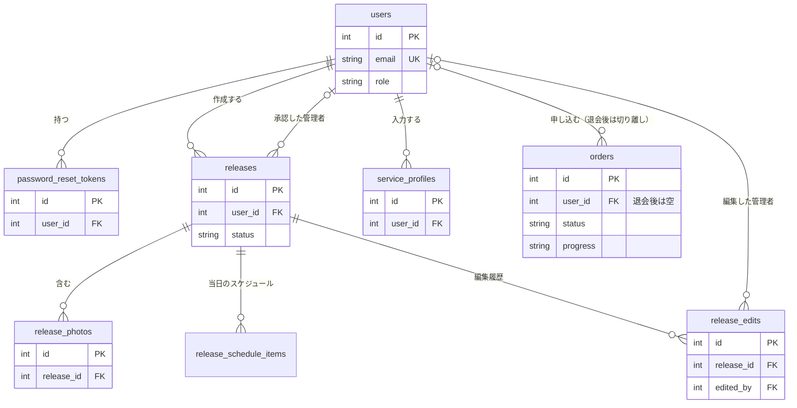
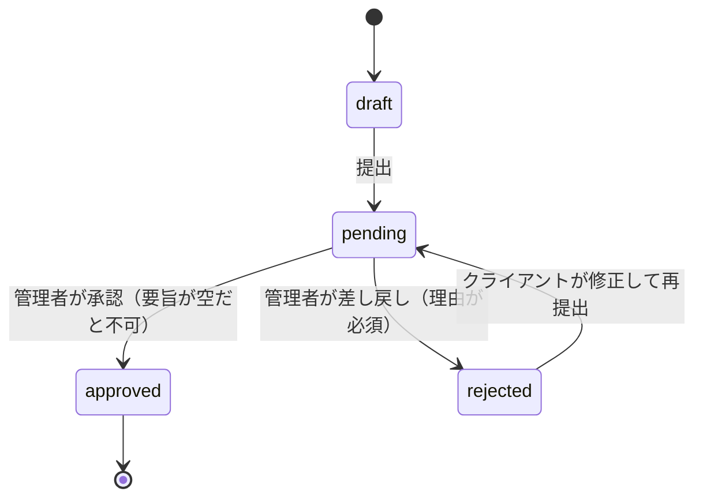
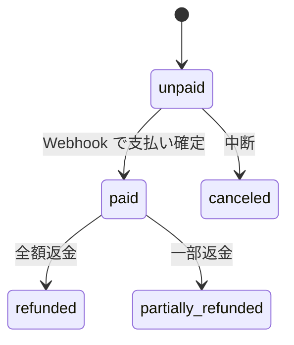

# データベース設計

元になる仕様：[仕様書.md](仕様書.md) の7章。設計は2段階で進める。

| 段階 | 内容 | 状態 |
| --- | --- | --- |
| 第1段階（このファイル） | 全体の関係図、状態の値、共通ルール、段階1で使うテーブルの詳細 | 作成済み |
| 第2段階 | 開発の各段階の前に、その段階で使うテーブルの詳細を追記する | 段階2（書類関連）：作成済み（6章）／段階3（注文関連）：作成済み（7章）／自社サービス入力：未着手 |

## 1. 全体の関係図（ER図）

## 2. 共通ルール

| 項目 | ルール | 理由 |
| --- | --- | --- |
| 文字コード | 本番（MySQL）は `utf8mb4` | 日本語・絵文字を正しく扱う |
| 日時 | UTC で保存し、画面表示のときに日本時間にする | 開発（SQLite）と本番（MySQL）の差を避ける |
| 金額 | 整数（円、税込）で保存する | 小数の誤差を避ける |
| 状態・種類 | 文字列（`VARCHAR`）で保存し、取りうる値はアプリ側で制限する | SQLite と MySQL で同じに動かすため（DB 固有の ENUM 型は使わない） |
| 主キー | 各テーブルに `id`（整数、自動採番） | |
| 作成・更新日時 | 主要テーブルに `created_at`、更新があるものには `updated_at` | |
| マイグレーション | Flask-Migrate（Alembic）で管理する。DB の変更は必ずマイグレーションにする | 本番への反映を安全にする |
| 本番での確認 | 公開前に MySQL で全テストを通す | 仕様書3章の注意のとおり |

## 3. 状態の値と遷移

### 3-1. 書類の状態（releases.status）

| 値 | 意味 |
| --- | --- |
| `draft` | 下書き（クライアントが入力中） |
| `pending` | 承認待ち（提出済み。管理者が要旨を書く・編集する・確認する） |
| `approved` | 承認済み（Word を出力済み。以後は編集不可） |
| `rejected` | 差し戻し（理由付き。クライアントが修正して再提出できる） |

- 無料枠の数え方：初めて提出した書類だけを数える。そのため `first_submitted_at`（初回提出日時）を持ち、差し戻し後の再提出では更新しない。
- `approved` の書類は、クライアント・管理者のどちらも編集できない。

### 3-2. 注文の状態（orders.status）と進捗（orders.progress）

| 状態 | 意味 |
| --- | --- |
| `unpaid` | 未払い（Stripe の支払いを開始した状態） |
| `paid` | 支払済（Webhook で確定） |
| `canceled` | 取消（支払い前に中断） |
| `refunded` | 返金済み（全額） |
| `partially_refunded` | 一部返金 |

| 進捗 | 意味 | 返金の目安 |
| --- | --- | --- |
| `received` | 受付（支払い確定で自動的にこの値になる） | 全額 |
| `in_progress` | 着手（管理者が更新した時点） | 50% |
| `delivered` | 納品済み | 不可 |

- `progress` は `paid` になってから使う（`unpaid` のときは空）。
- 返金後に進捗は戻さない。返金額の合計が支払額を超えないように、`refunded_amount` で管理する。

### 3-3. その他の値

| 項目 | 取りうる値 |
| --- | --- |
| users.role | `client`（初期値）、`admin` |
| orders.service_type | `interview_planning`（取材会の企画支援）、`interview_accompany`（取材会の同行）、`distribution_proxy`（投げ込み代行）、`article_creation`（記事作成）、`video_creation`（動画作成） |
| releases.summary_source（要旨の作成方法） | `manual`（管理者が作成）、`ai_assisted`（AI の案を管理者が修正。第2弾） |
| service_profiles.input_method | `text`、`voice`（第2弾） |

## 4. 削除したときの動き（退会・削除）

退会処理（仕様書 F21）では、ユーザー本人の行を削除し、注文は個人情報を消して残す。

| テーブル | ユーザー削除時の動き |
| --- | --- |
| password_reset_tokens | ユーザーと一緒に削除（`ON DELETE CASCADE`） |
| releases | 一緒に削除（CASCADE）。あわせて Word・写真のファイルも削除する |
| release_photos | 書類と一緒に削除（CASCADE）。ファイルも削除する |
| release_schedule_items | 書類と一緒に削除（CASCADE） |
| release_edits | 書類と一緒に削除（CASCADE） |
| service_profiles | 一緒に削除（CASCADE） |
| orders | **削除せず残す**。`user_id` を空にする（`ON DELETE SET NULL`）。素材の共有リンク・納品 URL・納品ファイルは削除する。金額・日付・サービス種別・状態などは残す |
| releases.approved_by / release_edits.edited_by | 管理者を指す。管理者の行は削除しない運用とし、万一削除したら空にする（`SET NULL`） |

## 5. テーブル詳細：段階1（認証）で使うもの

### 5-1. users

| 項目 | 型 | 必須 | 制約・メモ |
| --- | --- | --- | --- |
| id | 整数 | ○ | 主キー |
| email | 文字列(255) | ○ | **一意**。小文字にそろえて保存する |
| password_hash | 文字列(255) | ○ | ハッシュ化したパスワード（元のパスワードは保存しない） |
| session_nonce | 文字列(32) | ○ | セッションの世代（ランダム）。パスワードを変えると更新し、変更前のログイン状態をすべて無効にする |
| role | 文字列(20) | ○ | `client` / `admin`。初期値 `client` |
| company_name | 文字列(255) | ○ | 社名 |
| postal_code | 文字列(8) | ○ | 郵便番号。ハイフン付きの `123-4567` の形にそろえて保存する（入力は、ハイフンの有無・全角を許し、数字7桁に直してから整える） |
| address | 文字列(500) | ○ | 住所（都道府県から番地・建物名まで） |
| contact_name | 文字列(100) | ○ | 担当者名 |
| phone | 文字列(20) | ○（仮） | 電話番号。Word のお問い合わせ先に載せるため必須とする |
| mobile_phone | 文字列(20) | － | 携帯電話番号（任意） |
| logo_path | 文字列(500) | － | ロゴ画像の保存先（任意） |
| department | 文字列(100) | － | 担当部署（任意。お問い合わせ先に載せる） |
| founded | 文字列(50) | － | 設立（任意。「2015年4月」など、そのまま載せる文字列） |
| capital | 文字列(50) | － | 資本金（任意。「1,000万円」など） |
| employees | 文字列(50) | － | 従業員数（任意。「25名（2026年4月時点）」など） |
| business_description | 文章 | － | 事業内容（任意。最大500文字） |
| website_url | 文字列(500) | － | ウェブサイト URL（任意。`http://` か `https://` で始まるものだけ） |
| created_at | 日時 | ○ | |
| updated_at | 日時 | ○ | |

- 管理者（`admin`）は、会社情報の項目を使わないため、社名などは空文字でも作成できるようにする。`flask create-admin` では email とパスワードだけ指定する。
- インデックス：`email`（一意制約で自動的に付く）。

### 5-2. password_reset_tokens

| 項目 | 型 | 必須 | 制約・メモ |
| --- | --- | --- | --- |
| id | 整数 | ○ | 主キー |
| user_id | 整数 | ○ | `users.id` への外部キー（CASCADE） |
| token_hash | 文字列(64) | ○ | **一意**。再設定用の値は、ハッシュ化して保存する（DB が漏れても、そのままでは使えない） |
| expires_at | 日時 | ○ | 有効期限（仮：発行から1時間） |
| used_at | 日時 | － | 使用した日時。空でなければ使用済み（1回限り） |
| created_at | 日時 | ○ | |

- 新しい再設定リンクを発行したら、同じユーザーの古い未使用の行は無効にする。
- 期限切れの行は、定期的に削除する（開発の初期は手動でよい）。
- インデックス：`token_hash`（一意）、`user_id`。

## 6. テーブル詳細：段階2（書類作成）で使うもの

### 6-1. releases（プレスリリースの書類）

| 項目 | 型 | 必須 | 制約・メモ |
| --- | --- | --- | --- |
| id | 整数 | ○ | 主キー |
| user_id | 整数 | ○ | `users.id` への外部キー（CASCADE）。インデックスあり |
| title | 文字列(200) | ○ | タイトル（「【取材のお願い】」を除く）。全角換算で22文字以内（アプリ側で確認する。半角は0.5文字） |
| event_at_text | 文字列(200) | ○ | 日時。「2026年12月1日（火）14:00〜16:00」のように、そのまま載せる文字列（取材会の日時。期間や複数日があるため、日付型にしない） |
| location | 文字列(300) | ○ | 場所 |
| service_description | 文章 | ○ | サービスや商品の概要（最大1,000文字【仮】。設定で変更可） |
| feature_1 | 文字列(200) | ○ | 特徴1（1つ目は必須） |
| feature_2 | 文字列(200) | － | 特徴2 |
| feature_3 | 文字列(200) | － | 特徴3 |
| application_method | 文章 | ○ | 取材の申込方法（最大300文字。「下記のお問い合わせ先にメールでお申し込みください」など） |
| application_deadline | 文字列(100) | ○ | 申込の締切（「12月1日（月）17:00まで」など、そのまま載せる文字列） |
| source_what | 文章 | ○ | 要旨の元になる情報①：取材してほしい内容（最大500文字） |
| source_why | 文章 | ○ | ②：なぜ今これを行うのか（社会的意義・背景）（最大500文字） |
| source_message | 文章 | ○ | ③：読者・報道関係者に伝えたいこと（最大500文字） |
| summary | 文章 | － | 要旨（前文）。管理者が作成・確定する文章。空のままでは承認できない |
| summary_source | 文字列(20) | ○ | 要旨の作成方法。`manual`（初期値）／`ai_assisted`（第2弾） |
| status | 文字列(20) | ○ | 3-1の値。初期値 `draft`。インデックスあり |
| first_submitted_at | 日時 | － | 初回提出日時。一度入れたら変えない（無料枠の数え方に使う） |
| submitted_at | 日時 | － | 最新の提出日時（再提出のたびに更新）。管理者の一覧の並び順に使う |
| reject_reason | 文章 | － | 差し戻しの理由。再提出したら残したまま、次の差し戻しで上書きする |
| approved_by | 整数 | － | 承認した管理者（`users.id`、`SET NULL`） |
| approved_at | 日時 | － | 承認日時。Word の「発信日」に使う |
| last_edited_by | 整数 | － | 最後に編集した管理者（`users.id`、`SET NULL`） |
| last_edited_at | 日時 | － | 最終編集日時 |
| file_path | 文字列(500) | － | 承認時に出力した Word の保存先。`approved` のときだけ値がある |
| created_at / updated_at | 日時 | ○ | |

- インデックス：`user_id`、`status`、`(status, submitted_at)`（管理者が承認待ちを古い順に見るため）。
- 「写真」は、`release_photos` に持つ（このテーブルには列を持たない）。
- 企業情報（設立・資本金・従業員数・事業内容・URL）と会員情報（社名・住所・担当部署・担当者名など）は、書類には複製しない。Word を出力する時点の会員情報を使う。出力した Word は、承認後に会員情報を変えても変わらない。

#### 状態ごとの編集の許可

| 状態 | クライアント | 管理者 |
| --- | --- | --- |
| `draft`（下書き） | 要旨以外のすべての項目を編集できる。写真も追加・削除できる | 編集できない（承認待ちになってから） |
| `pending`（承認待ち） | **編集できない**（管理者が作業中のため） | 要旨を含むすべての項目を編集できる。編集履歴に残る |
| `rejected`（差し戻し） | 要旨以外のすべての項目を編集して再提出できる | 編集できない |
| `approved`（承認済み） | 編集できない。Word のダウンロードのみ | 編集できない |

#### 同時の操作への備え
- 提出・承認・差し戻し・編集・写真の追加と削除は、書類の行を「状態が期待どおりのときだけ更新する」1回の UPDATE でロックしてから行う。同時に来た別の操作は、先の操作が終わるまで待たされ、状態が変わっていれば失敗する（例：同時の承認と差し戻しは、どちらか一方だけが成立する）。
- 初めての提出と下書きの作成は、ユーザーの行もロックしてから件数を数える（同じ人が2件を同時に提出して、無料枠を超えないように）。
- 下書きとして同時に持てるのは3件まで（設定 `DRAFT_LIMIT`）。

#### 提出と無料枠のルール
- 無料枠の数え方：`first_submitted_at` が入っている書類の数（ユーザーごと）。上限は設定 `FREE_RELEASE_LIMIT`（初期値1）。
- 新規作成：上限に達していたら、下書きを作れない。
- 提出：すでに `first_submitted_at` がある書類（差し戻し後の再提出）はいつでも提出できる。初めての提出は、数えた件数が上限未満のときだけできる（下書きを複数作って、上限を超えて提出する抜け道を防ぐ）。
- 提出時に、必須項目（タイトル、日時、場所、サービスや商品の概要、特徴1、申込方法、締切、3つの元になる情報）が埋まっていることを確認する。

#### 承認のルール
- 承認できるのは `pending` のみ。承認時に、`summary` が空でないことを確認する。
- 承認すると、Word を出力して `file_path` に保存し、`status=approved`、`approved_by`、`approved_at` を同時に更新する。Word の出力に失敗したら、承認も取り消す（途中の状態を残さない）。
- 差し戻しには、`reject_reason`（必須）を書く。

### 6-2. release_photos（書類の写真）

| 項目 | 型 | 必須 | 制約・メモ |
| --- | --- | --- | --- |
| id | 整数 | ○ | 主キー |
| release_id | 整数 | ○ | `releases.id` への外部キー（CASCADE）。インデックスあり |
| position | 整数 | ○ | 1 または 2（Word に載せる順番）。`(release_id, position)` は一意 |
| file_path | 文字列(500) | ○ | 保存先（ランダムな名前） |
| original_filename | 文字列(255) | ○ | 元のファイル名（表示用。保存先の名前には使わない） |
| content_type | 文字列(50) | ○ | `image/jpeg`／`image/png`／`image/webp`（中身を確認して決める。送られた値は信用しない） |
| size_bytes | 整数 | ○ | ファイルの大きさ（5MBまで） |
| created_at | 日時 | ○ | |

- 1書類につき最大2枚。`position` が1か2のどちらかしか入らないことで、3枚目を防ぐ（アプリ側でも確認する）。
- 写真は横長だけ（横÷縦が1.2以上。EXIF の向きを反映した見た目で判定）。アップロード時に確認する。
- 書類が `approved` になった後も、写真のファイルは残す（Word に埋め込み済みだが、記録として）。退会時に削除する。

### 6-2b. release_schedule_items（当日のスケジュール）

| 項目 | 型 | 必須 | 制約・メモ |
| --- | --- | --- | --- |
| id | 整数 | ○ | 主キー |
| release_id | 整数 | ○ | `releases.id` への外部キー（CASCADE）。インデックスあり |
| position | 整数 | ○ | 1〜5（表の順番）。`(release_id, position)` は一意 |
| time_text | 文字列(50) | ○ | 時間（「14:00〜14:20」など、そのまま載せる文字列） |
| content | 文字列(200) | ○ | 内容 |

- 任意（0〜5行）。0行なら、Word の「当日のスケジュール」は見出しごと表示しない。
- 編集のたびに、その書類の行をまとめて入れ替える（個別に並べ替えはしない）。編集履歴には `schedule` として、変更前と変更後の表を文章にして残す。

### 6-3. release_edits（管理者の編集履歴）

| 項目 | 型 | 必須 | 制約・メモ |
| --- | --- | --- | --- |
| id | 整数 | ○ | 主キー |
| release_id | 整数 | ○ | `releases.id` への外部キー（CASCADE）。インデックスあり |
| edited_by | 整数 | － | 編集した管理者（`users.id`、`SET NULL`） |
| edited_at | 日時 | ○ | |
| field_name | 文字列(50) | ○ | 変更した項目名（`title`、`summary` など。写真は `photos`、スケジュールは `schedule`） |
| old_value | 文章 | － | 変更前の値（写真は「ファイル名」などの説明文） |
| new_value | 文章 | － | 変更後の値 |

- 管理者が保存したとき、実際に変わった項目だけを、1項目につき1行で記録する。
- クライアントへの通知（承認メールとマイページ）には、`summary` 以外の行だけを使う。
- 承認後は書き込まれない（編集できないため）。

### 6-4. ファイルの保存場所

| 種類 | 保存先（設定 `UPLOAD_DIR` の下） | 備考 |
| --- | --- | --- |
| 写真 | `releases/<書類id>/photos/<ランダム名>.<拡張子>` | 拡張子は、中身を確認した結果から決める |
| Word | `releases/<書類id>/release.docx` | 承認時に1回だけ作る |
| ロゴ | `users/<ユーザーid>/logo/<ランダム名>.<拡張子>` | 会員情報から登録・更新する |

- 開発：プロジェクトの `instance/uploads/`（Git に入れない）。本番：VM のディスク上の専用フォルダ（仕様書3章）。
- アップロードしたファイルは、画面から直接 URL では開けないようにし、権限を確認する専用の取得画面を通して返す（本人と管理者だけ）。

## 7. テーブル詳細：段階3（注文・決済）で使うもの

### 7-1. サービスの一覧（テーブルにはしない）

5種類のサービスの名前・説明・料金・納期の目安は、コード内の一覧（`app/services_catalog.py`）に持つ。DB には置かない。

| service_type | 名前 | 申込み時に入力するもの |
| --- | --- | --- |
| `interview_planning` | 取材会の企画支援 | なし |
| `interview_accompany` | 取材会の同行 | なし |
| `distribution_proxy` | 投げ込み代行 | なし |
| `article_creation` | 自社記事などに掲載する記事作成 | なし |
| `video_creation` | 自社記事などに掲載する動画作成 | 素材（写真・動画）の共有リンク（必須） |

- 料金は、未決のため**仮の金額**で作る（公開前に確定する。仕様書9章）。注文には、申込み時点の金額を保存する（あとで料金を変えても、過去の注文は変わらない）。
- 料金・納期の目安は、設定（環境変数）で上書きできるようにする。

### 7-2. orders（注文）

| 項目 | 型 | 必須 | 制約・メモ |
| --- | --- | --- | --- |
| id | 整数 | ○ | 主キー |
| user_id | 整数 | － | `users.id`（`SET NULL`）。退会後は空。インデックスあり |
| service_type | 文字列(30) | ○ | 3-3の値 |
| service_name | 文字列(100) | ○ | 申込み時のサービス名（退会後も何の注文か分かるように控える） |
| amount_yen | 整数 | ○ | 申込み時の金額（税込・円）。0 以上。Stripe は日本円で50円以上でないと決済できない |
| status | 文字列(20) | ○ | 3-2の値。初期値 `unpaid`。インデックスあり |
| progress | 文字列(20) | － | 3-2の値。`paid` になったとき `received` になる。それまでは空 |
| due_date | 日付 | － | 納期日（管理者が設定。クライアントに表示） |
| refunded_amount | 整数 | ○ | 返金額の合計。初期値 0。`amount_yen` を超えない（CHECK 制約） |
| refund_reason | 文章 | － | 返金の理由（管理者が記録） |
| materials_url | 文字列(500) | － | 動画の素材の共有リンク（動画作成のみ必須）。`http(s)` で始まるものだけ |
| delivery_file_path | 文字列(500) | － | 納品した記事ファイルの保存先（記事作成） |
| delivery_url | 文字列(500) | － | 納品した動画の URL（YouTube の限定公開リンク） |
| free_revisions_used | 整数 | ○ | 無料の修正を使った回数（管理者が記録）。初期値 0 |
| stripe_session_id | 文字列(255) | － | Checkout セッションの ID。**一意** |
| stripe_payment_intent_id | 文字列(255) | － | 支払いの ID。**一意**。返金のときに使う |
| paid_at | 日時 | － | Webhook で支払いが確定した日時 |
| created_at / updated_at | 日時 | ○ | |

- インデックス：`user_id`、`status`、`(status, created_at)`（管理者が支払済みの注文を新しい順に見るため）。
- 退会時：`user_id` を空にし、`materials_url`・`delivery_url`・`delivery_file_path`（とファイル）・`refund_reason` を消す。`service_name`・`amount_yen`・日付・状態・`refunded_amount` は残す。

### 7-3. stripe_events（受け取った Webhook の記録）

| 項目 | 型 | 必須 | 制約・メモ |
| --- | --- | --- | --- |
| id | 整数 | ○ | 主キー |
| event_id | 文字列(255) | ○ | Stripe のイベント ID。**一意**（同じイベントを2回処理しない） |
| event_type | 文字列(100) | ○ | `checkout.session.completed` など |
| received_at | 日時 | ○ | |

- 同じイベントが再送されても、2回目は何もせず成功を返す。
- 注文側の更新も「`unpaid` のときだけ `paid` にする」という条件つきの1回の UPDATE で行うので、イベントの記録が失敗しても、二重に処理されない。

### 7-4. 決済の流れ

1. クライアントがサービスを選んで申し込む（動画作成は素材のリンクも入力）→ `orders` に `unpaid` で作る。
2. Stripe Checkout のセッションを作る（金額・サービス名は、サーバー側で `orders` の値から作る。画面から送られた金額は使わない）。セッションの ID を `stripe_session_id` に保存し、Stripe の支払い画面へ移動する。
3. 支払い後、完了ページへ戻る。**この画面では支払いを確定しない**（表示だけ）。
4. Stripe から Webhook（`checkout.session.completed`）が届く → 署名を確認し、金額も注文と照合してから、`unpaid` → `paid`、`progress=received`、`paid_at`、`stripe_payment_intent_id` を更新し、注文確認メールを送る。
5. 中断ページに戻った場合や、セッションの期限切れ（`checkout.session.expired`）は、`unpaid` → `canceled`。
6. 返金は、管理者が金額を入力し、Stripe の返金 API を呼ぶ（二重に実行しないよう、注文ごとに一意のキーを付ける）。成功したら `refunded_amount` を加算し、全額なら `refunded`、一部なら `partially_refunded`。

## 8. 以降の段階で詳細を決めるテーブル

仕様書7章の案をもとに、各段階の前に追記する。ここには、先に決めた要点だけを書く。

| テーブル | 段階 | 決めてある要点 |
| --- | --- | --- |
| service_profiles | 5 | 自社サービスの入力（テキスト。音声は第2弾） |
